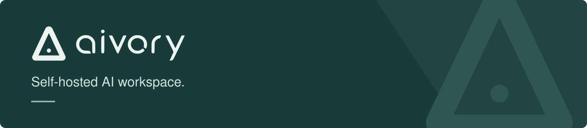
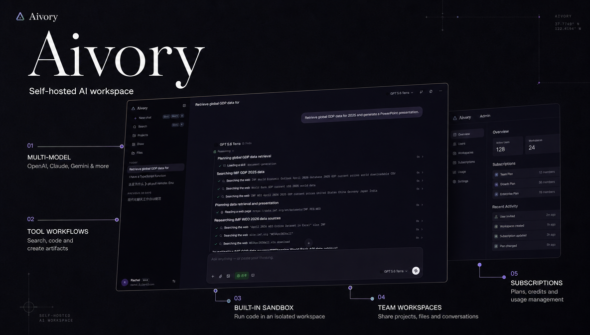
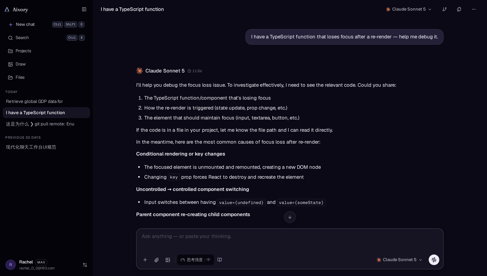
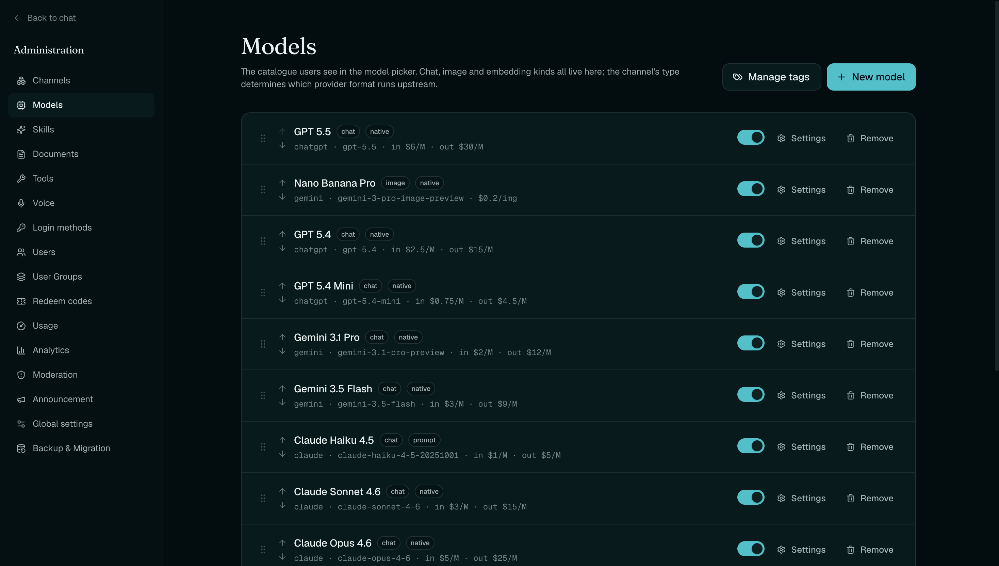
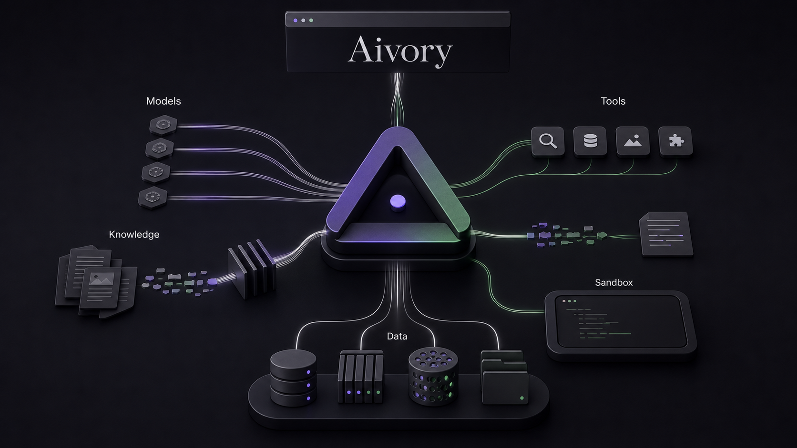

<p align="right">
  <strong>English</strong> · <a href="./README.zh-CN.md">简体中文</a>
</p>

<picture>
  <source media="(max-width: 600px)" srcset="docs/brand/readme-header-compact.svg">
  
</picture>

# Aivory

Aivory is a self-hosted AI workspace for individuals and teams. It brings conversations, research, creation, and shared knowledge together, while keeping control of the product and its data in your hands.

[Deployment guide](deploy/README.md) · [Product documentation](https://docs.aivorygo.com) · [Live demo](https://demo.aivorygo.com)

## Product

Aivory gives people one place to work with the AI services they choose. Conversations, files, research, and team projects stay together, so work can continue from an idea through to a finished result.

- **Conversations:** Use different AI models for different tasks, return to earlier work, and organize discussions in projects. Keep useful context close to the conversation instead of starting over in a separate service.
- **Research and creation:** Search for information, review web pages and documents, and ask follow-up questions in the same workflow. Turn the results into code, images, reports, spreadsheets, or presentations that can be reviewed and downloaded.
- **Knowledge:** Build libraries from the documents your team uses. Bring relevant passages into conversations and check the cited sources, making recurring research easier to reuse.
- **Personal and team workspaces:** Keep private conversations and files separate from shared team work. Invite teammates to selected workspaces and collaborate around shared projects, conversations, files, and knowledge.
- **Administration:** Configure available AI services, manage members and access, set plans and usage limits, review activity and costs, and maintain workspace features and backups from one place.

## Screenshots



<table>
  <tr>
    <td width="50%"></td>
    <td width="50%"></td>
  </tr>
</table>

## Product architecture

Aivory connects AI models, knowledge, everyday tools, and shared work in one workspace. The diagram shows how those parts come together from a user's perspective.



## Deploy

Deploy with Docker 24 or later and the Docker Compose plugin. Choose the personal profile for an individual server or the full profile for a team deployment.

### Full deployment

```bash
git clone https://github.com/hjxwz123/Aivory.git
cd Aivory/deploy
cp .env.example .env
```

Edit `.env` and set strong values for `POSTGRES_PASSWORD`, `REDIS_PASSWORD`, and `JWT_SECRET`. For a domain or HTTPS reverse proxy, also set `ALLOWED_ORIGINS` to the exact site origin, for example `https://chat.example.com`.

```bash
docker compose --env-file .env -f docker-compose.prod.yml pull
docker compose --env-file .env -f docker-compose.prod.yml up -d
```

Open the server address. The first account created through the setup page becomes the administrator. Add model provider credentials in **Admin → Channels**.

The OpenAI-compatible endpoint [A2Agent](https://a2agent.me) was tested with `deepseek-v4-flash` using Chat Completions, including streaming text, tool calls and tool-result continuation. This limited compatibility check is not a certification or endorsement.

### Personal deployment

```bash
git clone https://github.com/hjxwz123/Aivory.git
cd Aivory/deploy
cp .env.personal.example .env.personal
```

Set `JWT_SECRET` in `.env.personal` and set `ALLOWED_ORIGINS` when using a domain or HTTPS reverse proxy.

```bash
docker compose --env-file .env.personal -f docker-compose.personal.yml pull
docker compose --env-file .env.personal -f docker-compose.personal.yml up -d
```

The personal profile uses a single SQLite database and is intended for one app instance. Its persistent data is stored under `DATA_DIR` (default `deploy/data-personal`).

### Upgrade and restore

To deploy a specific release, set `IMAGE_TAG` in the active environment file to the release version without the leading `v`. If `APP_IMAGE_TAG` or `SANDBOX_IMAGE_TAG` is set, update it to the same version. Keep existing volumes and `DATA_DIR` in place.

```bash
# Full deployment
docker compose --env-file .env -f docker-compose.prod.yml pull
docker compose --env-file .env -f docker-compose.prod.yml up -d --no-build

# Personal deployment
docker compose --env-file .env.personal -f docker-compose.personal.yml pull
docker compose --env-file .env.personal -f docker-compose.personal.yml up -d --no-build
```

For a full backup restore, place the ZIP in `BACKUP_DIR`. The default host path is `deploy/data/backups` for the full profile and `deploy/data-personal/backups` for the personal profile. Open **Admin → Backup & Migration**, select **Restore from server directory**, and type `REPLACE`. Restore replaces all current data; keep a separate copy of the archive and back up the destination first.

For version-specific deployment, proxy configuration, storage paths, and recovery procedures, see the [deployment guide](deploy/README.md).

## Contributing

For substantial changes, open an issue before starting work. Pull requests should explain the problem being solved, describe the user-facing result, and include evidence that the change works.

## Acknowledgements

Thanks to the open-source communities and contributors behind [Qdrant](https://qdrant.tech/), [Radix UI](https://www.radix-ui.com/), and the projects and people who help improve Aivory.

## License

[Apache License 2.0](./LICENSE).
