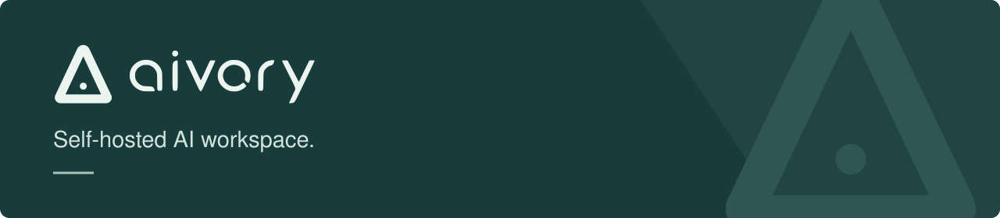
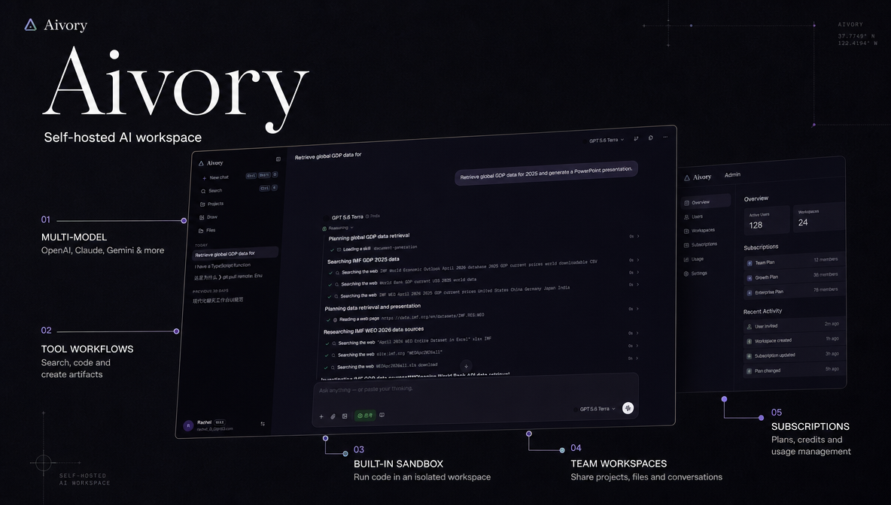
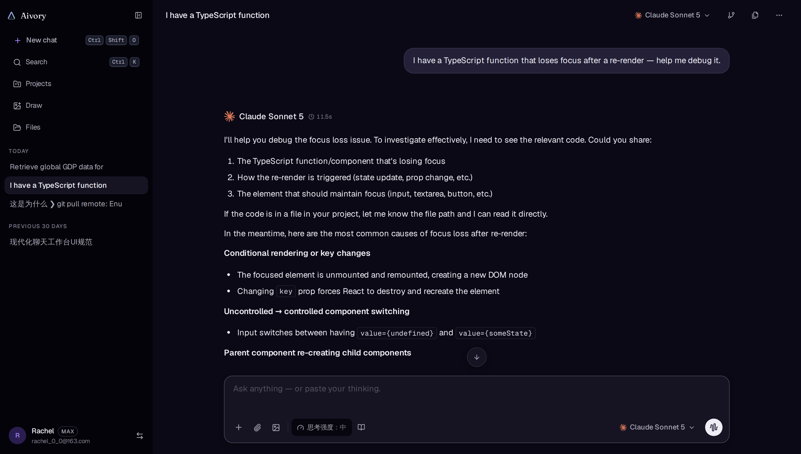
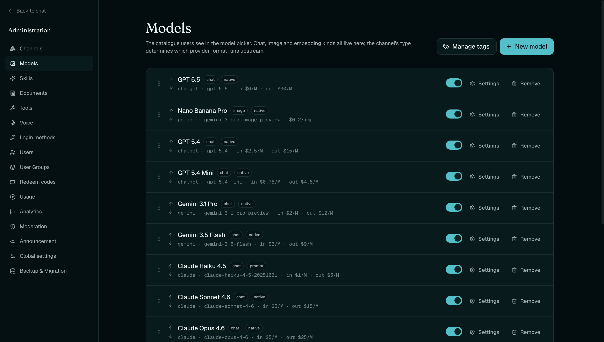
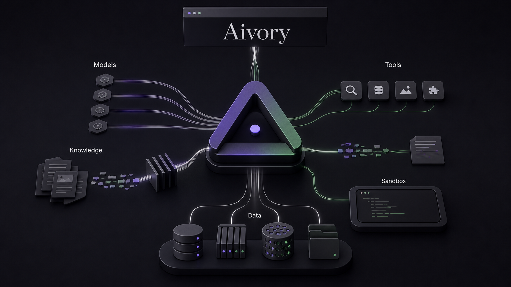

<p align="right">
  <a href="./README.md">English</a> · <strong>简体中文</strong>
</p>

<picture>
  <source media="(max-width: 600px)" srcset="docs/brand/readme-header-compact.svg">
  
</picture>

# Aivory

Aivory 是一个面向个人与团队的自部署 AI 工作空间，将对话、研究、创作与共享知识放在一起，让你始终掌控产品和自己的数据。

[部署指南](deploy/README.zh-CN.md) · [产品文档](https://docs.aivorygo.com) · [在线体验](https://demo.aivorygo.com)

## 产品介绍

Aivory 让你在一个空间里使用自己选择的 AI 服务。对话、文件、研究资料和团队项目集中保存，让一项工作可以从想法持续推进到完成，而不必在多个聊天网站间来回切换。

- **对话：** 为不同任务选择合适的 AI 模型，随时回到之前的讨论，并用项目整理相关对话。文件和已有上下文都留在工作旁边，后续可以接着推进。
- **研究与创作：** 搜索资料、阅读网页和文档，并在同一流程中继续提问。研究结果可以整理成代码、图片、报告、表格或演示文稿，供检查和下载。
- **知识：** 将团队常用文档整理成知识库，在对话中引用相关内容并查看来源，让重复研究更容易复用。
- **个人与团队空间：** 个人对话和文件与团队工作保持区分。邀请成员进入指定工作空间，围绕共享项目、对话、文件和知识一起协作。
- **管理：** 配置成员可用的 AI 服务，管理账号和访问权限，设置方案与使用额度，查看活动和成本，并维护工作空间功能及备份。

## 产品截图



<table>
  <tr>
    <td width="50%"></td>
    <td width="50%"></td>
  </tr>
</table>

## 产品架构

Aivory 将 AI 模型、知识、日常工具和团队协作连接在一个工作空间中。下图从产品使用角度展示各部分如何协同。



## 部署

需要 Docker 24 或更新版本及 Docker Compose 插件。个人版适合个人服务器，完整版适合团队部署。

### 完整版

```bash
git clone https://github.com/hjxwz123/Aivory.git
cd Aivory/deploy
cp .env.example .env
```

编辑 `.env`，为 `POSTGRES_PASSWORD`、`REDIS_PASSWORD` 和 `JWT_SECRET` 设置强密码。使用域名或 HTTPS 反向代理时，还要将 `ALLOWED_ORIGINS` 设置为网站的准确 Origin，例如 `https://chat.example.com`。

```bash
docker compose --env-file .env -f docker-compose.prod.yml pull
docker compose --env-file .env -f docker-compose.prod.yml up -d
```

打开服务器地址进入初始化页面。第一个创建的账号会成为管理员，然后在「管理后台 → 渠道」中添加模型服务商凭据。

[A2Agent](https://a2agent.me) 的 OpenAI 兼容端点已使用 `deepseek-v4-flash` 完成 Chat Completions 测试，覆盖流式文本、工具调用和工具结果续接。此测试仅代表有限的兼容性验证，不构成认证或背书。

### 个人版

```bash
git clone https://github.com/hjxwz123/Aivory.git
cd Aivory/deploy
cp .env.personal.example .env.personal
```

在 `.env.personal` 中设置 `JWT_SECRET`；使用域名或 HTTPS 反向代理时，也要设置 `ALLOWED_ORIGINS`。

```bash
docker compose --env-file .env.personal -f docker-compose.personal.yml pull
docker compose --env-file .env.personal -f docker-compose.personal.yml up -d
```

个人版使用单个 SQLite 数据库，适用于单个 app 实例。持久化数据位于 `DATA_DIR`，默认是 `deploy/data-personal`。

### 升级与恢复

部署指定版本时，在正在使用的环境文件中将 `IMAGE_TAG` 设置为版本号（不带开头的 `v`）。如果设置了 `APP_IMAGE_TAG` 或 `SANDBOX_IMAGE_TAG`，也要改成同一版本。保留现有数据卷和 `DATA_DIR`。

```bash
# 完整版
docker compose --env-file .env -f docker-compose.prod.yml pull
docker compose --env-file .env -f docker-compose.prod.yml up -d --no-build

# 个人版
docker compose --env-file .env.personal -f docker-compose.personal.yml pull
docker compose --env-file .env.personal -f docker-compose.personal.yml up -d --no-build
```

恢复全量备份时，将 ZIP 放入 `BACKUP_DIR`。完整版的默认宿主机目录是 `deploy/data/backups`，个人版是 `deploy/data-personal/backups`。进入「管理后台 → 备份与迁移」，选择「从服务器目录恢复」并输入 `REPLACE`。恢复会替换当前全部数据；请先单独备份目标服务器，并保留原归档副本。

指定版本部署、代理配置、存储目录和恢复处理步骤见[部署指南](deploy/README.zh-CN.md)。

## 参与贡献

较大的改动建议先提交 issue 讨论。Pull Request 请说明要解决的问题、用户能看到的变化，并提供改动有效的验证说明。

## 致谢

感谢 [Qdrant](https://qdrant.tech/)、[Radix UI](https://www.radix-ui.com/) 背后的开源社区，以及所有参与改进 Aivory 的项目和贡献者。

## 开源协议

[Apache License 2.0](./LICENSE)。
